[← Back to Lab 1 overview](index.qmd)

Notes on building a USV from the kit: wiring the autopilot and radios, then setting up the ground station and the autopilot through Mission Planner.

## Wiring

The autopilot is a CubePilot Cube Orange+.

- Copy the wiring of the example USV, and/or follow the [Cube wiring quick start](https://docs.px4.io/main/en/assembly/quick_start_cube).
- Telemetry radio: [RFD900x setup](https://mozzie.readthedocs.io/en/latest/RFD900xSetup.html).

## Mission Planner Setup

These steps generally follow the ArduPilot [Mission Planner setup guide](https://ardupilot.org/planner/docs/mission-planner-overview.html).

### Install Mission Planner

- Install **version 1.3.83** locally from the ZIP archive (not the MSI), following these instructions: [YouTube](https://www.youtube.com/watch?v=cw7adeD1yeg).
- Open Mission Planner (MP) and check that the title bar shows version 1.3.83.

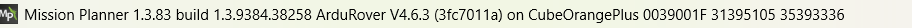{fig-alt="Mission Planner title bar showing version 1.3.83"}

### Install the Autopilot Firmware

- Open MP without connecting to the autopilot.
- In the **SETUP** tab, choose **Install Firmware**.
  - Select Rover V4.6.3 OFFICIAL.

    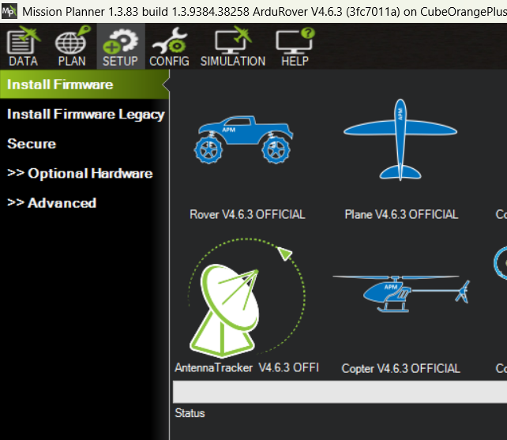{fig-alt="Install Firmware screen with Rover V4.6.3 OFFICIAL selected"}

  - Select the firmware options as follows:

    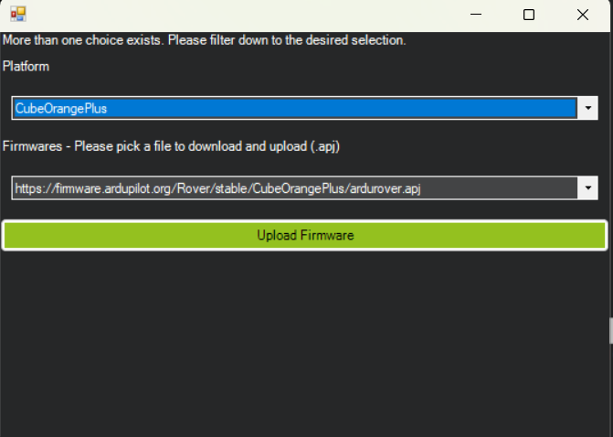{fig-alt="Firmware options selection"}

  - MP prompts you to start the firmware flash, then to connect the autopilot via USB.
- Check that the correct firmware is installed:
  - With the USB connection, use the AUTO port selection and click **CONNECT**.

    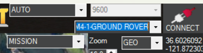{fig-alt="Port set to AUTO and the CONNECT button"}

  - After connecting, go to **PLAN → Messages** and look for the startup message "ArduRover V4.6.3 (3fc7011a)".

    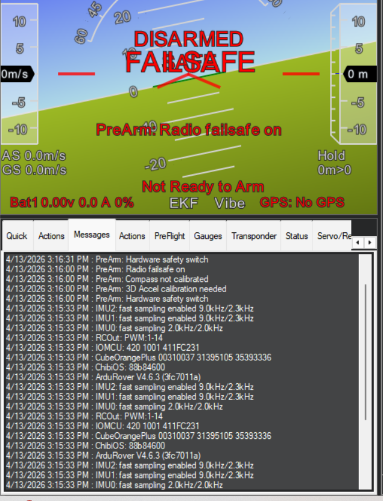{fig-alt="Messages tab showing the ArduRover V4.6.3 startup message"}

### Configure the R/C Transmitter

- On the transmitter (hold the wheel button while powering on): Create New Model → Channel Mapping → Channel Assign:
  - THRO: Elevator
  - AILE: Rudder
- Bind the receiver to the transmitter. MP can put the receiver in bind mode (see Radio Calibration below).

### Set Up the Firmware

Once connected with the updated firmware, go to **SETUP → Mandatory Hardware** in MP.

- Accel Calibration: choose the last option, simple calibration.

  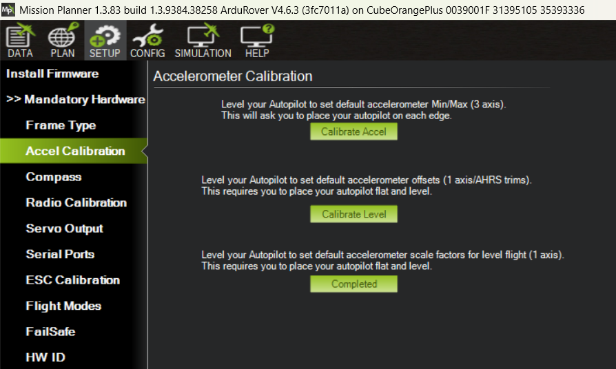{fig-alt="Accel calibration screen"}

- Compass: select "Large Vehicle MagCal".

  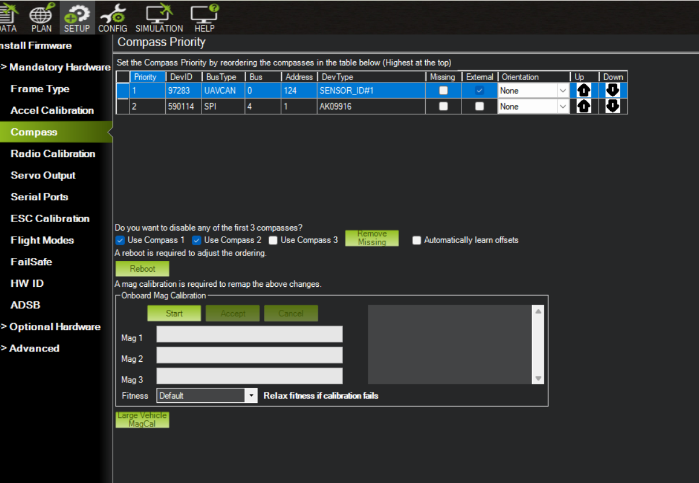{fig-alt="Compass calibration screen with Large Vehicle MagCal"}

- Radio Calibration. This is also where the Bind buttons are for re-binding the R/C receiver.

  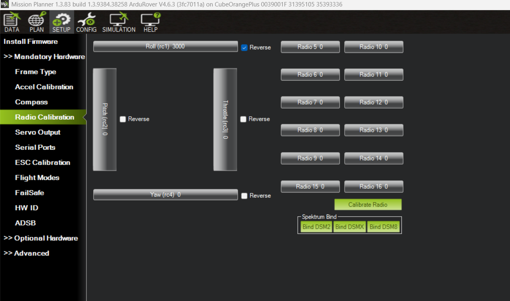{fig-alt="Radio calibration screen with bind buttons"}

- Servo Output: verify that it matches the following.

  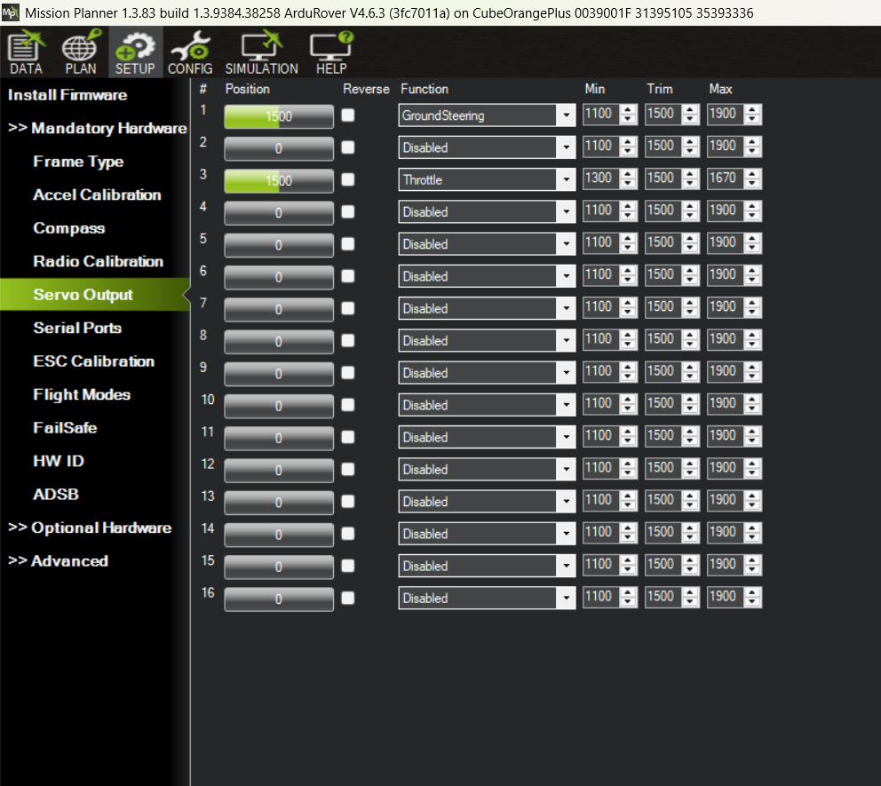{fig-alt="Servo output configuration"}

- ESC Calibration.

  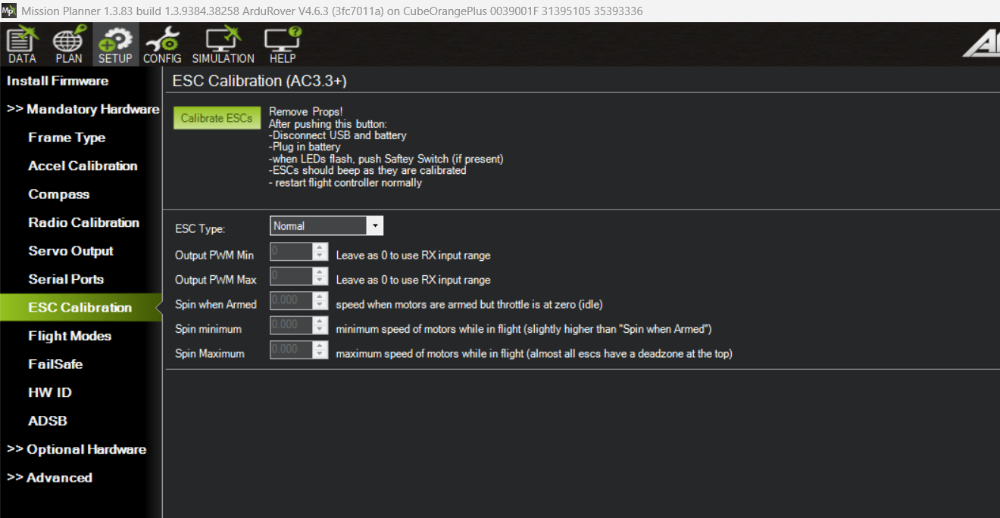{fig-alt="ESC calibration screen"}

- Flight Modes.

  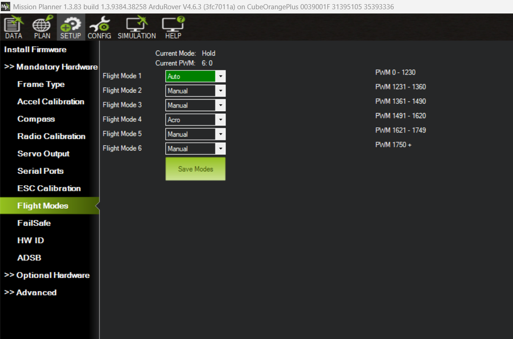{fig-alt="Flight modes configuration"}

### Load the ArduRover Parameters

Every USV reuses the parameters from the example USV.

- Download the baseline parameter file: [`2026_05_06_baseline_3.2.param`](https://github.com/bsb808/me2801/blob/main/utils/ardu_params/2026_05_06_baseline_3.2.param).
- In MP, go to **CONFIG → Full Parameter List → Load from File** and select the file you just downloaded.
